# The Crown Oddity

브라우저에서 바로 하는 작은 액션 RPG다. 3D 블록 지형 위에 픽셀 그림 캐릭터를 세우고, 화면 위아래를 흐리게 하는 틸트시프트와 빛번짐을 걸어 미니어처 정원을 내려다보는 느낌을 냈다. 전투는 이스 시리즈처럼 빠르게 베고 구르고 막는 방식이다.

**지금 하기:** https://destory1984.github.io/oddity-of-the-wilds/ (첫 로딩 약 45MB)

처음 이름은 Oddity of the Wilds였다. 이야기가 왕관과 태엽 정원 쪽으로 커지면서 2026-10-23에 이름을 바꿨다. 저장소 주소는 그대로 둔다.

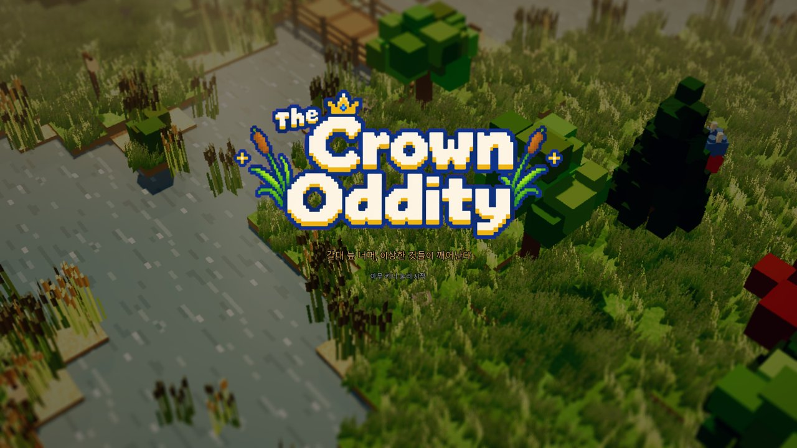

## 이야기

소라는 갈대늪에서 기억 없이 깨어난다. 가진 것은 머리 위의 작은 금관 하나뿐이다.

이 땅은 옛날 달지기들이 만든 커다란 태엽 정원이다. 달지기들은 여덟 밤마다 왕관으로 정원의 태엽을 감아 물이 흐르고 풀이 자라게 했다. 마지막 달지기 한결이 백 년 전 정원 한가운데로 혼자 들어가 돌아오지 않았다. 그 뒤로 아무도 태엽을 감지 않아 땅이 장난감 벽돌로 굳어 가고 있다.

소라가 왕관을 쓰고 나타나자, 굳은 벽돌들이 "왕관을 정원 한가운데로"라는 옛 명령을 따라 깨어나 달려든다.

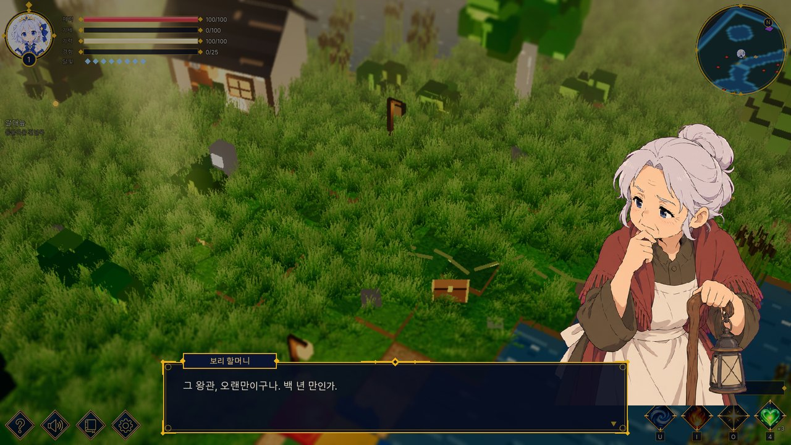

## 장

| 장 | 지역 | 하는 일 |
|---|---|---|
| 1 | 갈대늪 | 깨어나기, 첫 등불 켜기, 보리 할머니의 오두막 상점, 보스 벽돌왕, 지도 조각 3개와 달지기 상자, 달이 찬 밤에만 피는 달꽃 |
| 2 | 지하 동굴 | 벽 그림, 열쇠 문, 맞수 노을과의 첫 만남, 보스 굴파기 수레두더지, 물수제비 걸음 얻기, 기술 하나를 깨우는 세 돌단, 낮은 음부터 울리는 수정 수수께끼, 벽돌 박쥐 |
| 3 | 등불 마을 | 주민 4명의 심부름 5개(밤의 늪에서 반딧불 잡기 포함), 노을이 마을 등불 12개를 끄는 밤, 노을과 첫 대결, 다섯 무리를 버티는 달빛 시련, 들어가 볼 수 있는 집 5채, 도란의 편지 세 통, 보름달 밤의 등불 축제 |
| 4 | 남쪽 호수 | 굳은 수문 풀기, 물결의 배로 섬에 건너가기, 보스 벽돌 거북, 물결이 동료가 됨, 섬 밑 물빛 동굴과 보스 벽돌 게, 호숫가 낚시(다섯 종류) |
| 5 | 굳은 숲 | 벽돌 벽 3개 풀기, 달 순서 돌 수수께끼, 벽돌 우리에 갇힌 다람쥐 5마리, 벽돌 늑대 무리, 노을과 두 번째 대결, 노을이 동료가 됨 |
| 6 | 바람 언덕 | 멈춘 풍차 3개 감기, 바람 다리, 방패 고블린, 보스 벽돌 매, 25초 바람개비 경주, 바람구멍으로 건너는 구름 둔덕과 보스 벽돌 허수아비, 왕관으로 비춰야 보이는 구름길 |
| 7 | 가라앉은 달지기 성 | 벽돌 성문 풀기, 물수제비와 바람구멍으로 건너기, 한결의 일기 3장, 달 문, 지렛대 셋으로 여는 보물고, 보스 벽돌 기사 |
| 8 | 정원 한가운데 | 거푸집을 재우는 벽돌 봉인 셋 풀기, 마지막 보스 굳은달 거푸집(3단계), 주민들이 등불을 켜는 동안 거푸집 조각 막기, 땅 감기, 끝 장면 |

처음부터 끝까지 이어서 할 수 있다. 끝을 본 뒤 정원 한가운데서 E를 두 번 누르면 새 바퀴가 시작된다. 레벨과 지닌 것은 남고, 괴물은 바퀴마다 0.5배씩 더 단단하고 아파진다. 지금 놀 수 있는 분량은 약 200분이고, 목표는 5시간(300분)이다. 진행률은 약 67%다.

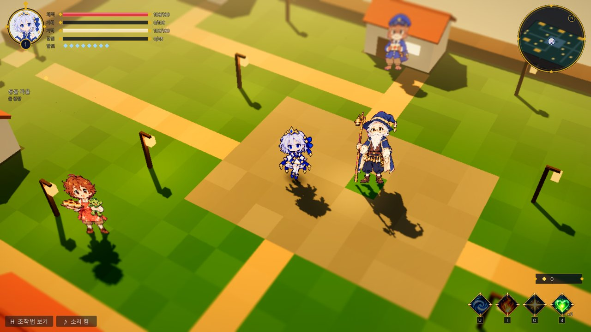

## 조작

| 키 | 하는 일 |
|---|---|
| WASD, 방향키 | 이동 (8방향) |
| Shift | 달리기 (기력 사용). 물수제비 걸음을 얻은 뒤에는 물 위를 달린다 |
| J, 왼쪽 클릭 | 공격 (연속기) |
| K, 오른쪽 클릭 | 구르기 (기력 25). 맞기 0.15초 전에 구르면 섬광 피하기: 2초 동안 적이 4배 느려짐 |
| L, 가운데 클릭 (누르고 있기) | 막기: 앞쪽 공격 피해 70% 줄임. 맞기 0.12초 전에 누르면 섬광 막기: 피해 0, 다음 베기 2.5배 |
| U I O, 1 2 3 | 스킬: 회오리(기세 30), 불씨탄(기세 15), 빛파동(기세 60) |
| 4 | 회복약 (체력 45 회복) |
| E | 왕관 쓰기: 등불 켜기, 벽돌 풀기, 풍차 감기, 말 걸기, 지렛대, 낚시, 구름길 비추기, 달빛 길돌(가 본 길돌로 건너가기, 숫자 키로 고름) |
| Space | 상자 열기, 상점과 집 들어가기 (보리 할머니는 E로도 된다) |
| T | 3시간 보내기 (밤에만 나오는 반딧불, 달꽃, 보름달 축제를 기다릴 때) |
| Z X, 휠 | 확대·축소 |
| M 또는 화면 왼쪽 아래 단추 | 소리 켜고 끄기 |
| H | 조작법 창 |
| Q 또는 화면 왼쪽 아래 단추 | 일지: 지금 할 일, 찾은 곁이야기와 진행, 도전 과제 6가지, 지닌 것 |
| F8 / F9 | 처음 자리로 (진행은 그대로) / 처음부터 (저장 지우기) |

## 전투와 성장

- 기세는 베기를 맞힐 때마다 5, 섬광 피하기 20, 섬광 막기 25씩 찬다. 4초 동안 못 때리면 줄어든다.
- 적을 맞히면 0.05 → 0.14초 동안 화면이 멈춰 손맛을 준다. 괴물은 때리기 전에 0.45초 동안 빨갛게 부풀고 머리 위에 "!"가 뜬다.
- 레벨이 오르면 최대 체력 +12, 공격력 +3을 얻고, 몇몇 레벨에서 새 기술이 열린다.

| 레벨 | 새 기술 |
|---|---|
| 2 | 4타 연속기 (넷째 타는 한 바퀴 베기) |
| 3 | 달려 베기 (Shift로 달리며 J, 3m 앞으로 베며 나감) |
| 4 | 모아 베기 (L로 1초 막아 빛을 모은 뒤 J, 피해 3배) |
| 6 | 5타 연속기 (다섯째 타는 땅 내려찍기) |
| 8 | 빛 칼날 (연속기 마지막 타가 빛 칼날을 날림) |

- 왕관의 달빛 눈금은 8칸이다. 등불 켜기, 벽돌 풀기, 풍차 감기에 쓰고, 밤에 켜진 등불 곁에서 쉬면 10초마다 1칸 찬다. 낮에는 왕관 힘이 약해 더 많이 든다.
- 보스는 10마리다. 벽돌왕 950, 수레두더지 650, 노을 550과 830, 벽돌 거북 900, 벽돌 게 760, 벽돌 매 780, 벽돌 허수아비 820, 벽돌 기사 1100, 굳은달 거푸집 1700의 체력을 가진다. 벽돌 기사는 앞에서 오는 공격을 방패로 막는다. 옆이나 뒤를 치거나 섬광 막기로 틈을 만든다.
- 동료 물결은 장대로 찌르고, 노을은 벽돌 가루를 던져 함께 싸운다.

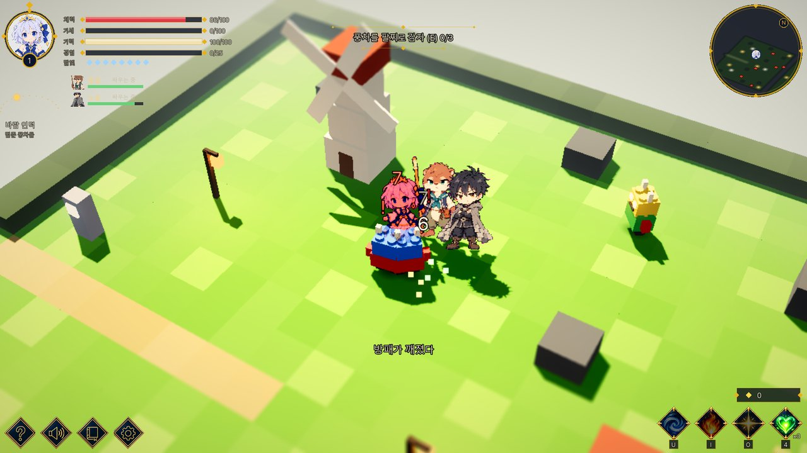

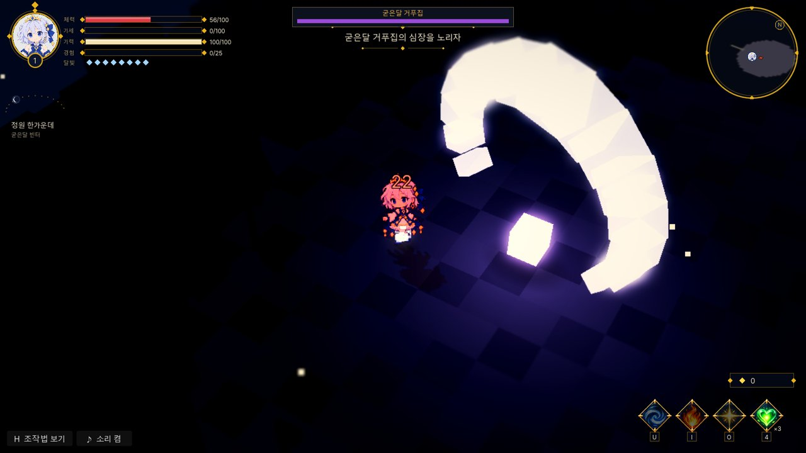

## 화면 몇 장

| | |
|---|---|
| 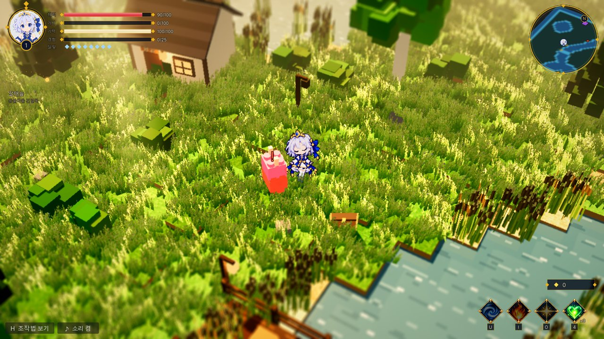 | 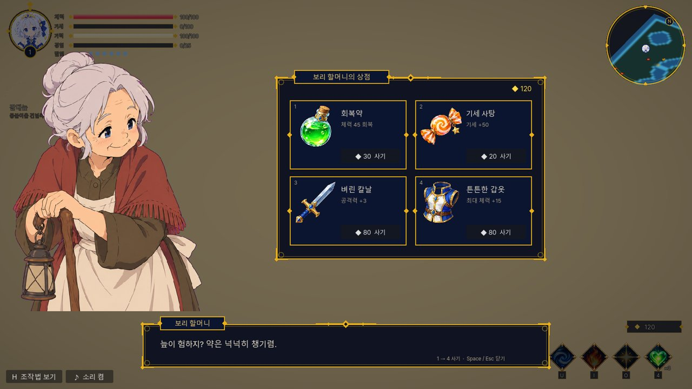 |
| 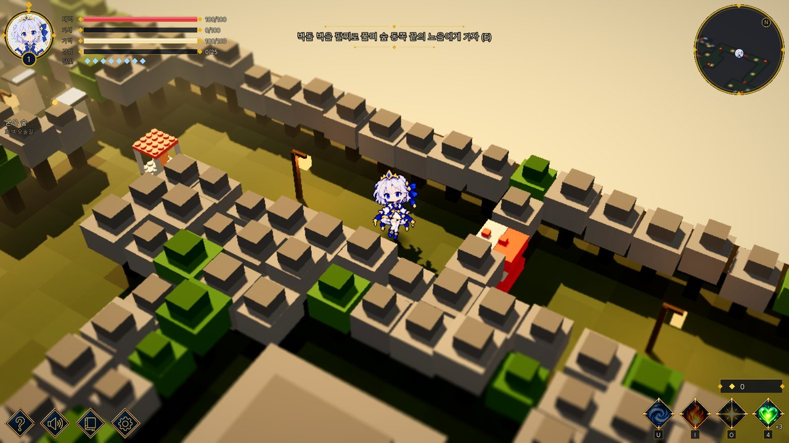 | 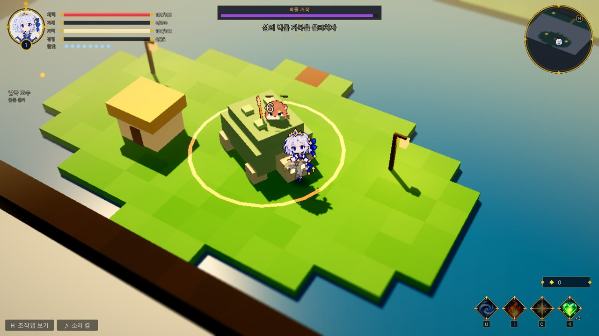 |
| 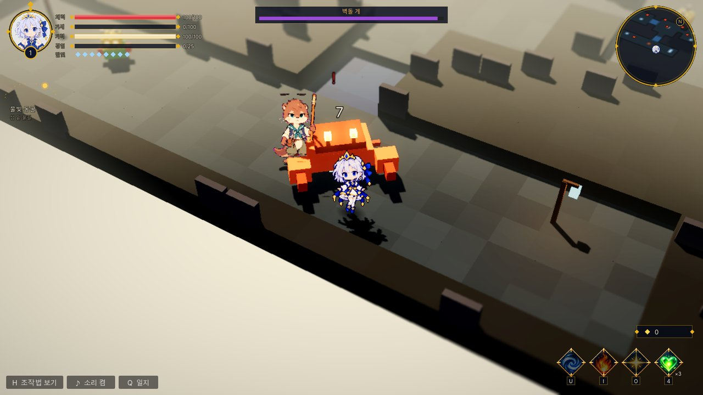 | 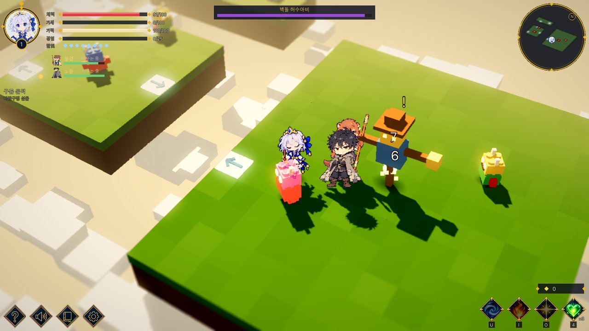 |
| 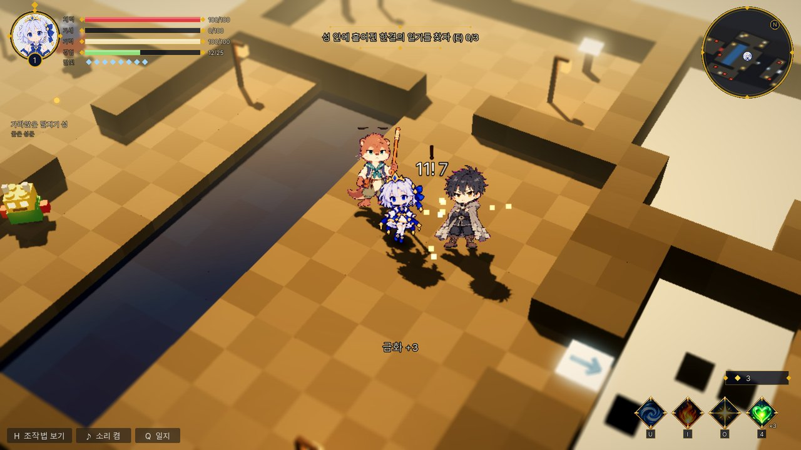 | 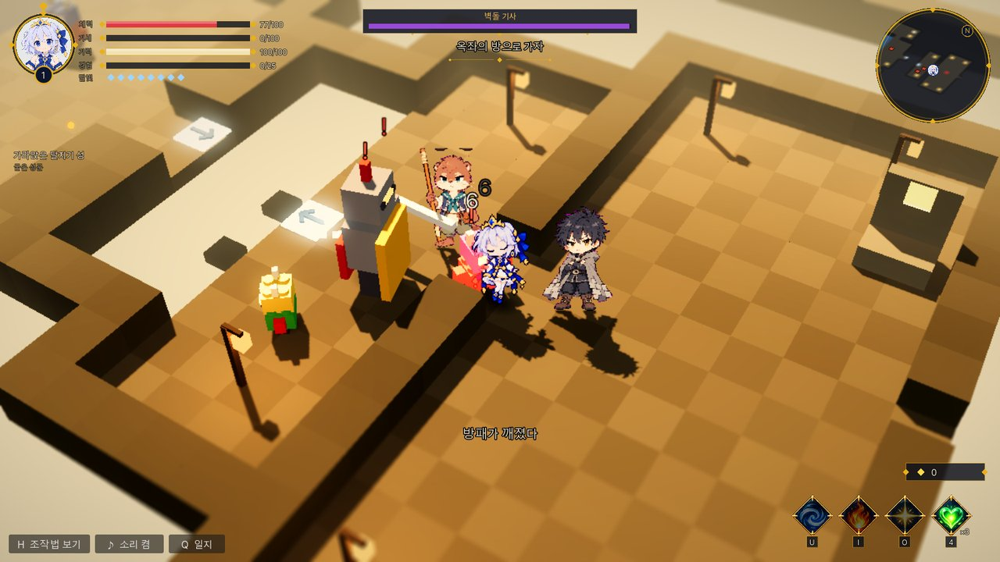 |
| 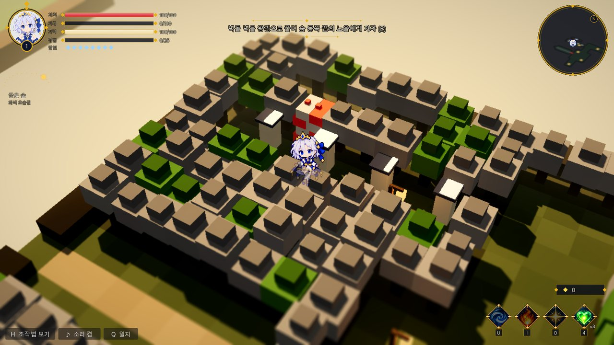 | 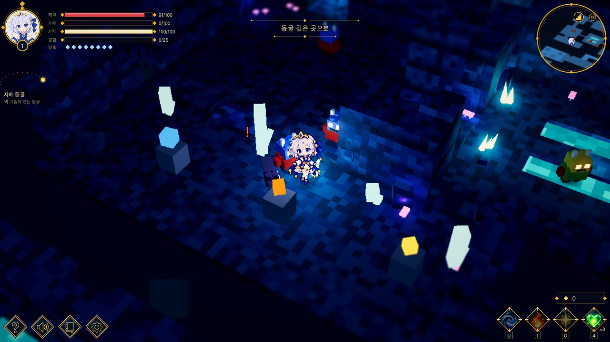 |
| 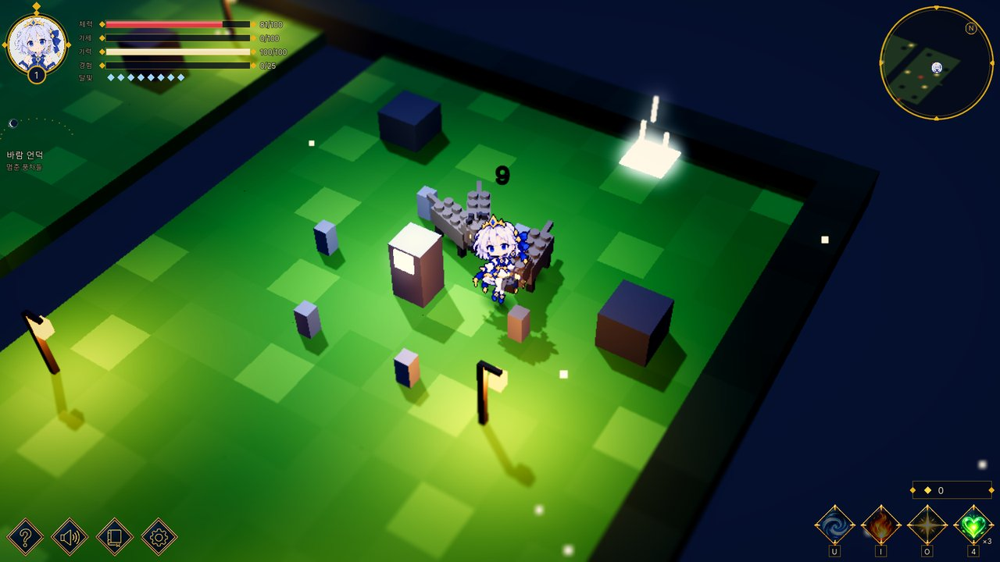 | 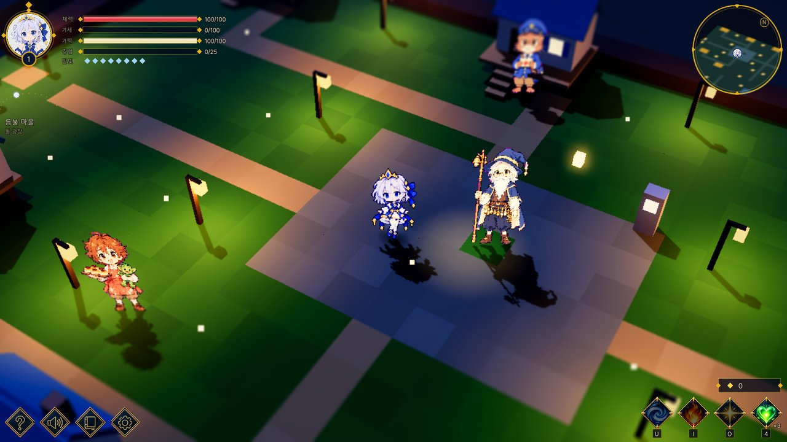 |
| 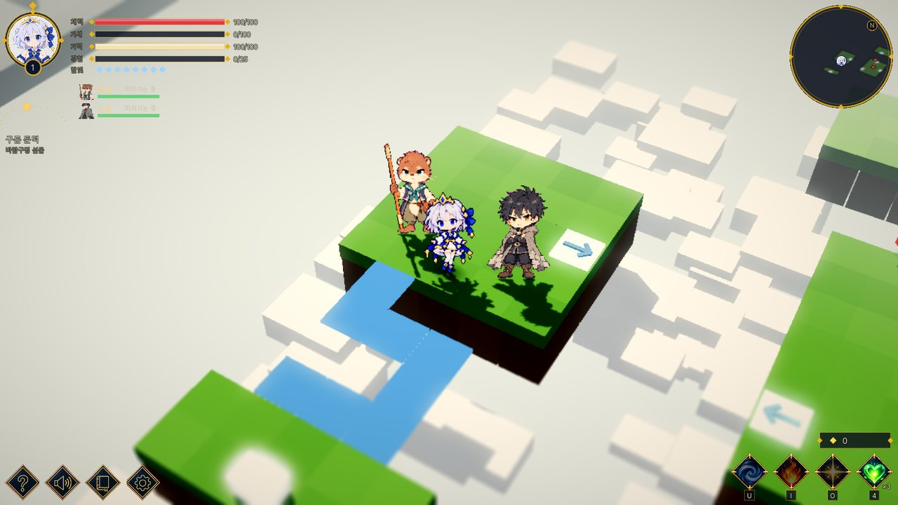 | 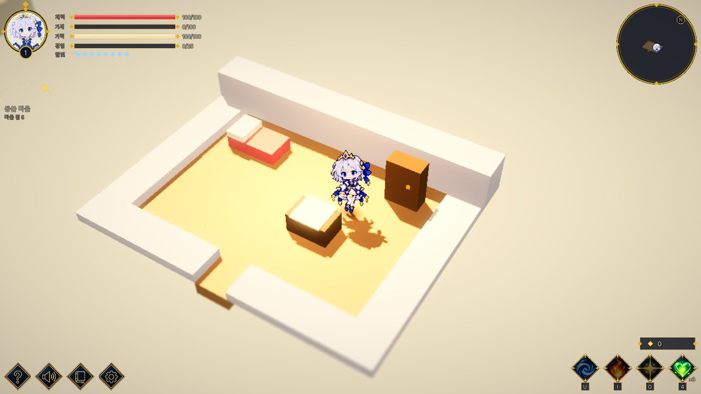 |

## 바뀐 것

날짜별로 바뀐 것은 [CHANGES.md](CHANGES.md)에 따로 적는다.

## 만든 방법

- 엔진은 Godot 4.7이고, 웹으로 내보낸 결과를 이 저장소 맨 위에 둔다. 게임은 거의 모두 코드로 짓는다. 지형, 집, 나무, 괴물은 상자를 쌓아 만들고, 풀과 부들과 물 무늬는 코드에서 찍는다.
- Godot 프로젝트 원본은 `godot/` 폴더에 있다. Godot 4.7에서 그 폴더를 열고 F5를 누르면 돈다.
- 그림은 GPT 이미지 생성(Codex CLI)으로 그렸다. 걷기 8방향, 주민과 노을의 픽셀 그림, 초상화, 이야기 삽화 12장, 상점 물건 아이콘이 그렇다. 소라가 가만히 서서 하는 몸짓 49가지는 같은 작가의 다른 프로젝트 Space Oddity의 그림을 가져왔다.
- 화면에 나오는 글 약 540줄은 번역 표(`godot/i18n/text.csv`)를 거친다. 지금은 한국어만 채웠고, 영어·일본어·중국어 칸은 비어 있다.
- 효과음은 코드에서 합성한다. 글꼴은 Pretendard를 쓴다.
- 자동 시험 88개가 처음 깨어나기부터 끝 장면까지 따라가며 확인한다.

## 이 폴더에서 직접 열기

로컬 서버를 띄운다.

```
python -m http.server 8765
```

그다음 `http://localhost:8765` 를 연다.

## 라이선스

- 코드: MIT 라이선스. 마음대로 고치고 써도 된다.
- 소라 캐릭터(디자인과 모든 그림, 게임 데이터에 든 것 포함)와 제목 그림: destory1984의 것이다. 모든 권리를 가진다(All rights reserved). MIT에 들어가지 않으므로 허락 없이 복사, 수정, 배포, 다른 작품에 쓰기를 할 수 없다. 코드를 가져다 쓰려면 캐릭터를 자기 것으로 바꿔야 한다.
- 글꼴: Pretendard, SIL 오픈 폰트 라이선스 1.1.

전체 문구는 `LICENSE` 에 있다.
